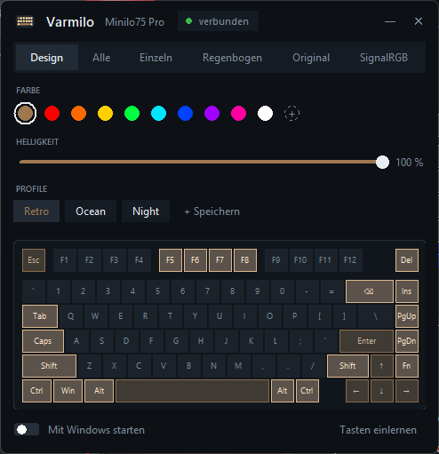

# Varmilo RGB

Per-key lighting for the **Varmilo Minilo75 Pro** on Windows: a small always-on-top overlay with a tray icon, and a SignalRGB plugin. No vendor software needed.



- **Overlay:** pick a mode (a two-tone design, one colour, single keys, rainbow), click keys to paint them, set the brightness and save looks as profiles.
- **SignalRGB plugin:** SignalRGB effects on the keyboard. One click in the overlay hands the keyboard to SignalRGB and back.
- **Tray icon:** closing the window keeps the lighting running. It can start hidden with Windows.
- **Safe:** it only uses the keyboard's temporary direct mode. It never writes to the keyboard's flash memory, so unplugging always brings back the original lighting.

The interface is in German.

## Installation

Open PowerShell and run:

```powershell
irm https://raw.githubusercontent.com/laurensanp/varmilo-rgb/main/install.ps1 | iex
```

The installer asks whether it should start with Windows, whether to start it right away and, if SignalRGB is installed, whether to add the plugin. It needs Python 3.9 or newer (`winget install Python.Python.3.12`). Feel free to [read the script](install.ps1) first.

To update or uninstall, run the same line again.

## Good to know

- **Cable only:** the lighting can only be controlled over the USB cable. Over the 2.4 GHz dongle the keyboard uses its own lighting.
- **Layout:** the key map ships for the ANSI layout. For another layout, click **Tasten einlernen** and press each key once.
- **Speed:** the keyboard accepts one LED command about every 7 ms, so fast, detailed SignalRGB effects look choppy. Slow and full-board effects look fine.
- **Pressed keys flash white:** the keyboard's firmware does that itself. The overlay and the plugin paint over it right away, so only a short flash is left.
- **SignalRGB:** keep the plugin's Lighting Mode on **Auto** (the default). The overlay and SignalRGB then take turns without fighting over the keyboard.

## Troubleshooting

- **The icon doesn't show up after a restart:** check `%APPDATA%\VarmiloOverlay\error.log`.
- **"USB-Kabel nicht gefunden":** plug in the cable. The keyboard is found again automatically.
- **SignalRGB doesn't show the keyboard:** restart SignalRGB once after installing the plugin.

## How it works

The keyboard (USB ID `062A:856B`, MosArt chip) has a vendor HID interface with a direct mode: `0x91` enters it, `0x92` fills all LEDs, `0x93` sets one LED and `0x90` leaves it. Feature report `0x13` reads back what the LEDs show, which is how pressed keys are caught and how the key map was learned. While the overlay is in charge it keeps a heartbeat on an unused LED slot; the plugin steps back while that heartbeat moves.

The protocol is close to the Redragon K596's, documented in [peshke/k596-signalrgb](https://github.com/peshke/k596-signalrgb).

## Development

```powershell
pip install -r requirements.txt
python overlay_test.py
node plugin_test.mjs
python varmilo_overlay.py
```

- `varmilo_overlay.py`: the overlay and tray app
- `Varmilo_Minilo75_Pro.js`: the SignalRGB plugin
- `varmilo.py`: a small command-line tool for direct-mode tests
- `install.ps1`: the installer

## License

[MIT](LICENSE)
